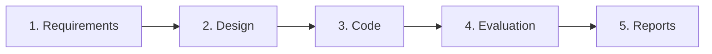
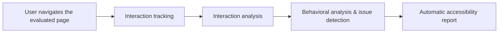

# A4A – Access for All: Accessibility Evaluation Platform

**A4A (Access for All)** is an online platform that guides teams through the whole accessibility lifecycle of a digital product, from the first requirements to a final accessibility report. It brings requirements, design, code, evaluation and reporting together in one place, so accessibility is built in from the start instead of being checked only at the end.

I work on A4A as an **MSc Research Fellow** at the Human-Computer Interaction Laboratory of ICS-FORTH, and it is also the basis of my master's thesis.

> **About the code:** A4A is developed at the HCI Lab of ICS-FORTH, and its source code belongs to the lab, so it is not public. This repository presents the project, my role and the system's main ideas.

---

## The five steps of A4A

| Step | What happens |
|---|---|
| **1. Requirements** | Define the accessibility requirements of the product and its target users |
| **2. Design** | Create designs or import existing ones and check them for accessibility issues early |
| **3. Code** | Check the implementation against accessibility guidelines |
| **4. Evaluation** | Plan and run evaluations with real users and analyze how they interact with the product |
| **5. Reports** | Automatically generate structured accessibility reports from the results |

---

## My role

- **Research:** I started by studying existing accessibility evaluation systems and how they approach evaluation. This analysis revealed a gap: most tools check the code against guidelines, but few look at how real users, with different abilities and assistive technologies, actually experience a page.
- **Designing the innovative part of the evaluation:** based on that gap, I designed and built the evaluation features that make A4A different (see below).
- **Full-stack development** of the evaluation system:
  - **Front end:** React and TypeScript
  - **Back end:** Node.js (NestJS), REST APIs
  - **Database:** MongoDB
  - **Platform features:** user authentication and login, role-based access, notifications, and an evaluation calendar similar to Google Calendar for planning and scheduling evaluation sessions

---

## Behavior-based accessibility evaluation (MSc thesis, ongoing)

**Thesis:** *Automated Analysis and Report Generation of Accessibility Evaluation using Artificial Intelligence*

Instead of only scanning a page's code, A4A observes **how real users navigate the evaluated page** and detects accessibility and usability problems from their behavior.

1. **Tracking:** user interactions are recorded while participants navigate the evaluated page.
2. **Analysis:** the interaction data is processed to identify behavioral indicators of difficulty.
3. **Issue detection:** accessibility and usability errors are recognized and **categorized by user group and assistive technology**:

   | User group | Examples of assistive technologies |
   |---|---|
   | Blind users | Screen readers |
   | Users with low vision | Screen magnifiers, high contrast |
   | Users with cognitive disabilities | Simplified navigation and content |
   | Users with motor impairments | Keyboard-only navigation, switch devices |

4. **Reporting:** an **accessibility report is generated automatically**, mapping the detected issues to WCAG 2.1/2.2 so evaluators can understand and prioritize what to fix first.

---

## Technologies

React · TypeScript · Node.js · NestJS · REST APIs · MongoDB · Authentication & role-based access · Notifications · WCAG 2.1/2.2

---

## Screenshots

*Screenshots coming soon.*

---

## Status

**Ongoing.** The platform is in active development, and the behavior-based evaluation is the subject of my master's thesis.

---

## Acknowledgments

Developed at the Human-Computer Interaction Laboratory, Institute of Computer Science, Foundation for Research and Technology – Hellas (FORTH).

**Contact:** Vasia Pitikaki · [LinkedIn](https://www.linkedin.com/in/vasia-pitikaki-1a5525370/) · basia.pitikaki@gmail.com
